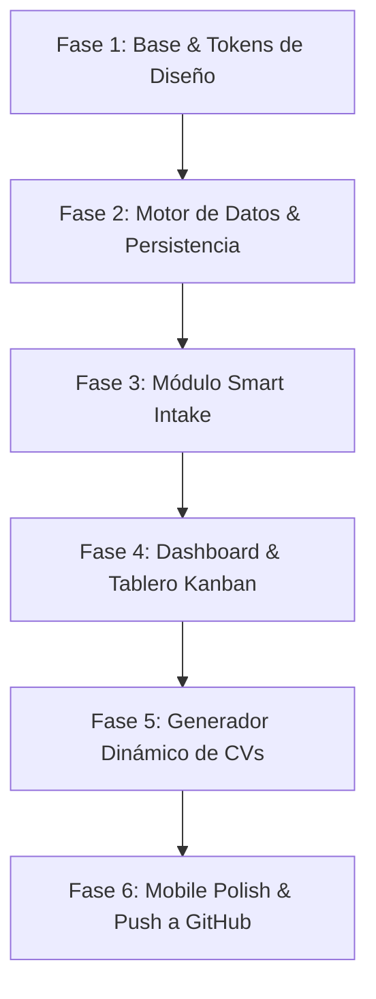

# Plan de Implementación: Sistema de Gestión de Vacantes (Vacantes by AryC)

**Propietaria:** Arianna Clemente  
**Repositorio GitHub:** [vacantesbyaryc](https://github.com/aryclemente/vacantesbyaryc.git)  
**Sistema de Diseño:** [Electric Neo-Architect](file:///c:/Users/user/Desktop/Busqueda de Trabajo/DESIGN.md)  
**Plataforma de Despliegue:** Netlify (Mobile-First SPA)

---

## 1. Objetivos del Plan
Construir una aplicación web moderna, ágil y visualmente atractiva según las especificaciones de diseño, enfocada en eliminar el trabajo manual repetitivo en la búsqueda de empleo mediante:
1. **Ingesta Inteligente (Smart Intake):** Registro de vacantes mediante pegado de texto largo o capturas de pantalla (`Ctrl+V`), extrayendo los datos clave con IA.
2. **Seguimiento Visual & KPIs:** Tablero Kanban táctil y vista de tabla con filtros, precargado con el historial extraído de Gemini.
3. **Generador Dinámico de CVs:** Generación en HTML/CSS de CVs adaptados por vacante y descarga instantánea en PDF sin costo de almacenamiento.
4. **Despliegue Continuo:** Lista para ser publicada en Netlify y accesible desde el teléfono móvil.

---

## 2. Fases de Ejecución

### Fase 1: Arquitectura y Sistema de Diseño (Electric Neo-Architect)
- **Estructura del Proyecto:**
  - `index.html`: Estructura semántica, metadatos SEO y enlaces a Google Fonts (*Plus Jakarta Sans* e *Inter*).
  - `css/tokens.css` y `css/styles.css`: Variables CSS del sistema de diseño (Púrpura `#4d17d6`, Hot Pink `#FF2E93`, Mint `#00D2B4`, superficies y glassmorphism).
  - `js/app.js`: Controlador principal y enrutador modular de vistas.
  - `netlify.toml`: Configuración de encabezados y redirecciones para Netlify.
- **Entregables:**
  - Sistema de tokens y utilidades CSS operativas.
  - Contenedor mobile-first responsive con barra de navegación y panel superior.

---

### Fase 2: Motor de Datos, Almacenamiento y Carga Inicial
- **Persistencia Local (`storage.js`):**
  - Implementación con `IndexedDB` y `localStorage` para almacenamiento persistente y privado en el navegador.
  - Métodos CRUD completos: crear vacante, actualizar estado, eliminar y archivar.
  - Funciones de **Exportar a JSON** y **Restaurar respaldo** para sincronizar entre dispositivos si es necesario.
- **Datos Semilla (Seed Data):**
  - Precarga de las 16 vacantes/empresas ya extraídas del chat de Gemini (Ensolvers, Banesco, Ventana Digital, Wink, etc.) en sus respectivos estados iniciales.
- **Entregables:**
  - Capa de datos reactiva con persistencia automática garantizada.

---

### Fase 3: Módulo Smart Intake (Fase 1 de Captación con IA)
*Cero fricción: registro sin llenar campos uno por uno.*
- **Interfaz de Captura:**
  - Área multimodal inteligente:
    - Campo de pegado rápido de URL original.
    - Caja de texto para pegar descripciones extensas de ofertas o conversaciones de reclutadores.
    - Zona de pegado directo de capturas de pantalla (`paste` de portapapeles `Ctrl+V`, drag & drop o selector de archivos móvil).
- **Motor de Extracción:**
  - Integración con API de Gemini (modelo multimodal `gemini-1.5-flash` / `gemini-2.0-flash`) mediante API Key configurable en ajustes del usuario.
  - Parser inteligente local con heurísticas y expresiones regulares como respaldo cuando no haya API Key configurada.
  - Extracción automática de:
    - Puesto / Título de vacante.
    - Empresa.
    - Modalidad (Remoto, Híbrido, Presencial).
    - Salario estimado o rango.
    - Requisitos técnicos / Palabras clave ATS.
    - Contacto / Reclutador identificado.
- **Modal de Confirmación Rápida:**
  - Vista previa editable de los campos extraídos con botón de 1 clic: **"Guardar en el Tablero"**.
- **Entregables:**
  - Módulo de ingesta operativa con soporte para texto y capturas de pantalla.

---

### Fase 4: Dashboard, Tablero Kanban y Vistas de Gestión
- **Métricas y Tarjetas KPI:**
  - Conteo dinámico de postulaciones activas, vacantes en entrevista, ofertas recibidas y tasa de conversión.
  - Indicador "Live Pulse Dot" en mint turquoise para ofertas en seguimiento caliente.
- **Tablero Kanban:**
  - Columnas por estado:
    1. `Guardadas / Por postular`
    2. `Postuladas`
    3. `En Proceso / Entrevistas`
    4. `Oferta Recibida`
    5. `Descartadas / Congeladas`
  - Soporte de cambio de estado táctil en móvil y drag & drop en escritorio.
- **Vista Alternativa de Lista / Tabla:**
  - Tabla compacta con filtros rápidos (por modalidad, empresa, prioridad) y barra de búsqueda en tiempo real.
- **Detalle de Vacante:**
  - Modal con bitácora de eventos, notas de seguimiento, fechas de entrevistas y acceso al CV asociado.
- **Entregables:**
  - Navegación fluida entre Kanban y Lista con filtros y actualización en vivo.

---

### Fase 5: Generador Dinámico de CVs (HTML & Descarga en PDF)
- **Plantilla de CV Profesional:**
  - Diseño minimalista, elegante y 100% amigable con ATS (basado en el estilo bancario y técnico de ModernCV).
  - Componentes de: Encabezado profesional, Resumen ejecutivo, Experiencia laboral relevante, Habilidades técnicas clave y Formación.
- **Personalización por Vacante:**
  - Posibilidad de adaptar el pitch o las palabras clave específicas para la postulación seleccionada sin alterar el perfil base.
- **Generador de PDF bajo demanda:**
  - Estilos de impresión optimizados con `@media print` para renderizado en 1 página limpia.
  - Botón prominente en Hot Pink (`#FF2E93`): **"Descargar PDF"** que genera el archivo directamente en el navegador con un solo clic.
  - Cero consumo de almacenamiento en la nube.
- **Entregables:**
  - Editor interactivo de CV y exportación instantánea a PDF lista para enviar a reclutadores.

---

### Fase 6: Optimización Mobile, Despliegue en Netlify y Git Push
- **Verificación Mobile-First:**
  - Menú inferior / barra de navegación adaptada a pantallas táctiles.
  - Zonas de toque accesibles (mínimo 44px) y contraste accesible.
- **Sincronización con GitHub:**
  - Commit organizado y push a la rama `main` del repositorio `aryclemente/vacantesbyaryc`.
- **Configuración de Netlify:**
  - Archivo `netlify.toml` preparado para despliegue con 1 clic desde GitHub o arrastrando la carpeta.
- **Entregables:**
  - Aplicación publicada y funcional, accesible desde cualquier dispositivo móvil o de escritorio.

---

## 3. Cronograma de Pasos Inmediatos

| Paso | Acción | Estado |
| :---: | :--- | :---: |
| **1** | Aprobación del plan y validación de componentes | ✅ Completado |
| **2** | Creación de la estructura base y diseño en CSS (Electric Neo-Architect) | ✅ Completado |
| **3** | Implementación de `storage.js` y carga de las 16 vacantes de Gemini | ✅ Completado |
| **4** | Creación del componente Smart Intake (texto + capturas de pantalla) | ✅ Completado |
| **5** | Implementación del Tablero Kanban y Vista Lista con Métricas y Filtros | ✅ Completado |
| **6** | Implementación del Generador de CVs y exportación a PDF | ✅ Completado |
| **7** | Push al repositorio GitHub y preparación para Netlify | ✅ Completado |

