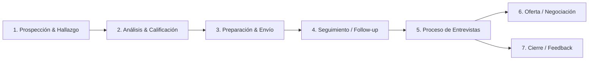

# Sistema de Gestión de Solicitudes de Vacantes (Personal ATS)
**Propietaria:** Arianna Clemente  
**Objetivo:** Gestionar, organizar y optimizar el ciclo de vida completo de búsqueda y postulación a oportunidades laborales.

---

## 1. Visión General del Proyecto
Un sistema personal centralizado que permita registrar cada oferta laboral, dar seguimiento a cada etapa del proceso de selección (desde la postulación hasta la oferta o cierre), almacenar versiones de CVs/portafolios adaptados, y generar métricas de efectividad de las postulaciones.

---

## 2. Ciclo de Vida de una Postulación (De Inicio a Fin)

### Fase 1: Prospección y Detección de Oportunidades
- **Fuentes:** LinkedIn, Portales de empleo (InfoJobs, Indeed, Computrabajo, etc.), Sitios de carreras empresariales, Networking / Referencias directas.
- **Datos iniciales a capturar:**
  - Nombre del puesto y empresa.
  - Enlace a la vacante / captura de la descripción.
  - Modalidad (Remoto, Híbrido, Presencial) y Ubicación.
  - Rango salarial ofrecido o estimado.
  - Requisitos clave y tecnologías solicitadas.

### Fase 2: Análisis de Ajuste (Job Match)
- Comparación entre los requisitos de la vacante y el perfil actual.
- Nivel de prioridad o interés (Alta, Media, Baja).
- Estrategia de postulación (Referido, Postulación directa en web, InMail/Reclutador).

### Fase 3: Preparación y Personalización
- Versión específica del CV utilizada (enlace o archivo).
- Carta de presentación / Pitch adaptado.
- Repositorio de enlaces compartidos (Portafolio, GitHub, LinkedIn).

### Fase 4: Registro y Envío de la Solicitud
- Fecha exacta de envío.
- Plataforma/vía utilizada.
- Persona de contacto / Reclutador (Nombre, rol, correo/LinkedIn).
- Estado: `Enviada`.

### Fase 5: Seguimiento (Follow-Up)
- Recordatorios automáticos para enviar mensajes de seguimiento (ej. a los 7 días de enviar).
- Bitácora de comunicaciones (correos recibidos, mensajes en LinkedIn).
- Estados intermedios: `Revisión de perfil`, `En espera de respuesta`.

### Fase 6: Rondas de Entrevistas
- Registro de cada fase:
  1. *Filtro inicial (HR Screening / Llamada de contacto)*.
  2. *Entrevista técnica / Caso práctico / Prueba técnica*.
  3. *Entrevista con Hiring Manager / Stakeholders*.
  4. *Entrevista cultural / Directiva*.
- Para cada entrevista:
  - Fecha, hora y plataforma (Meet, Teams, Zoom).
  - Entrevistadores y notas clave.
  - Preguntas realizadas y retroalimentación recibida.
  - Tareas o compromisos acordados.

### Fase 7: Decisión, Negociación y Cierre
- **Oferta recibida:**
  - Detalles de la oferta: Salario bruto/neto, beneficios, días de vacaciones, fecha de inicio.
  - Puntos de contraoferta o negociación.
  - Estado: `Aceptada` o `Rechazada por postulante`.
- **Desestimada / Sin avance:**
  - Causa del rechazo (si hubo feedback).
  - Aprendizajes clave para futuras postulaciones.
  - Estado: `Descartada` o `Puesto congelado`.

---

## 3. Modelo de Datos Propuesto

Para estructurar la información, se consideran las siguientes entidades:

### Entidad: Vacante / Postulación (`Application`)
| Campo | Tipo | Descripción |
| :--- | :--- | :--- |
| `id` | UUID / Autoincrement | Identificador único |
| `puesto` | Texto | Título de la vacante |
| `empresa` | Texto / Relación | Nombre de la compañía |
| `url_vacante` | URL | Link original de la publicación |
| `modalidad` | Selección | Remoto / Híbrido / Presencial |
| `ubicacion` | Texto | Ciudad / País |
| `salario_min` | Numérico | Rango salarial mínimo |
| `salario_max` | Numérico | Rango salarial máximo |
| `fecha_postulacion` | Fecha | Día en que se envió la solicitud |
| `estado` | Selección | Guardada, Postulada, En Proceso, Oferta, Rechazada |
| `prioridad` | Selección | Alta, Media, Baja |
| `cv_utilizado` | Texto/URL | Ruta o versión del CV enviado |
| `notas` | Texto largo | Observaciones y apuntes clave |

### Entidad: Contactos de Selección (`Recruiters / Contacts`)
- Nombre, Apellidos, Cargo, Correo, Perfil LinkedIn, Empresa vinculada.

### Entidad: Eventos / Entrevistas (`InterviewEvent`)
- Postulación asociada, Tipo de fase, Fecha y hora, Entrevistadores, Link de reunión, Notas de la reunión.

---

## 4. Métricas y KPIs de la Búsqueda
- **Tasa de Respuesta:** (Respuestas recibidas / Postulaciones enviadas) * 100
- **Tasa de Conversión a Entrevista:** (Entrevistas agendadas / Postulaciones enviadas) * 100
- **Embudo de Selección:** Visualización de cuántas vacantes avanzan de fase.
- **Tiempos de Ciclo:** Promedio de días desde la postulación hasta la primera respuesta y oferta final.

---

## 5. Arquitectura y Decisiones de Implementación

### 5.1 Plataforma y Despliegue
- **Tipo de Aplicación:** Web App (SPA) responsive, con diseño **Mobile-First** optimizado para consultas rápidas desde el teléfono móvil y gestión detallada desde escritorio.
- **Despliegue:** **Netlify** (integración continua, HTTPS automático, CDN global y carga instantánea).
- **Persistencia de Datos:**
  - Almacenamiento local mediante `IndexedDB` / `localStorage` para funcionamiento autónomo y rápido.
  - Copias de seguridad automáticas con exportación/importación en formato JSON.
  - Compatibilidad para sincronización multi-dispositivo (opcional vía Supabase / Firebase o Netlify Blobs).

### 5.2 Módulo de Ingesta Inteligente (Fase 1 - Smart Intake)
*Objetivo:* Cero fricción al registrar una vacante, eliminando el llenado manual campo por campo.
- **Entrada Flexible:**
  - **Caja de texto masivo / Chat:** Pegar directamente el texto completo de la oferta, descripción de LinkedIn o notas de conversación.
  - **Capturas de pantalla (Paste / Drop):** Pegado directo desde el portapapeles (`Ctrl + V` en desktop o selector en móvil) y subida de imágenes.
  - **URL de la vacante:** Campo prioritario para enlazar a la fuente original de la postulación.
- **Motor de Extracción:**
  - Procesamiento con IA multimodal (ej. API de Gemini) para interpretar el texto o la imagen de la captura y extraer automáticamente:
    - Puesto / Rol.
    - Empresa.
    - Modalidad (Remoto, Híbrido, Presencial).
    - Ubicación.
    - Rango Salarial / Compensación.
    - Requisitos y palabras clave (ATS Keywords).
    - Contacto / Reclutador identificado.
  - Vista previa de confirmación rápida con 1 clic para guardar.

### 5.3 Generador Dinámico de CVs (HTML & Exportación a PDF)
- **Principio de almacenamiento eficiente:** No se almacenan archivos binarios PDF pesados en servidores/nube.
- **Estructura:**
  - Cada vacante tiene asociado un CV adaptado en formato de datos (JSON) y plantilla HTML/CSS limpia.
  - Diseño ATS-friendly optimizado con reglas `@media print`.
- **Descarga bajo demanda:**
  - Botón accesible siempre: **"Descargar PDF"**.
  - Generación en el navegador (vectorial, nítida y ligera) lista para enviar.
  - Capacidad de editar el contenido del CV en cualquier momento y volver a descargar el PDF actualizado.

